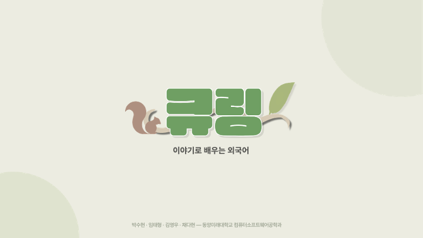
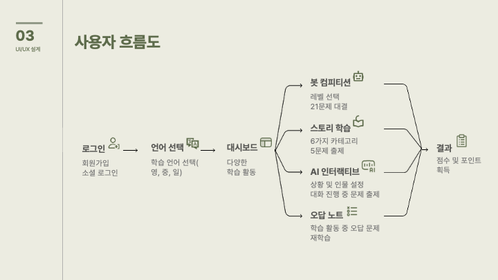
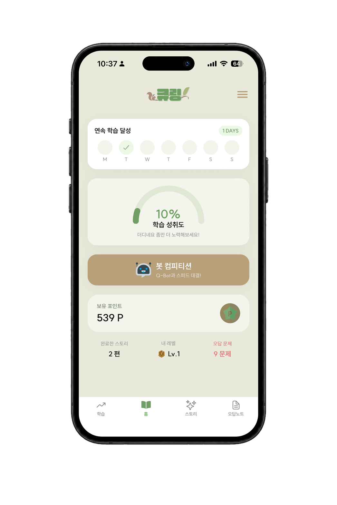
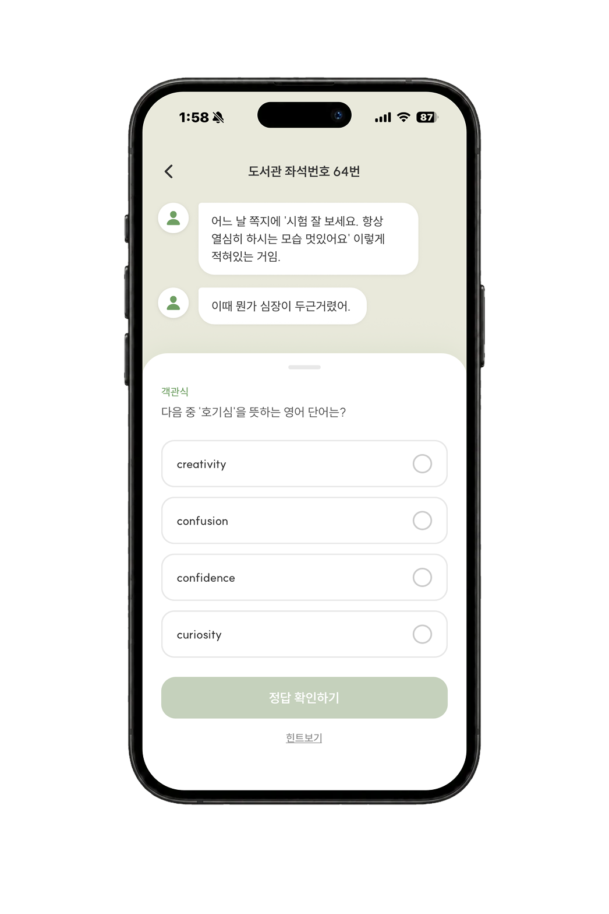
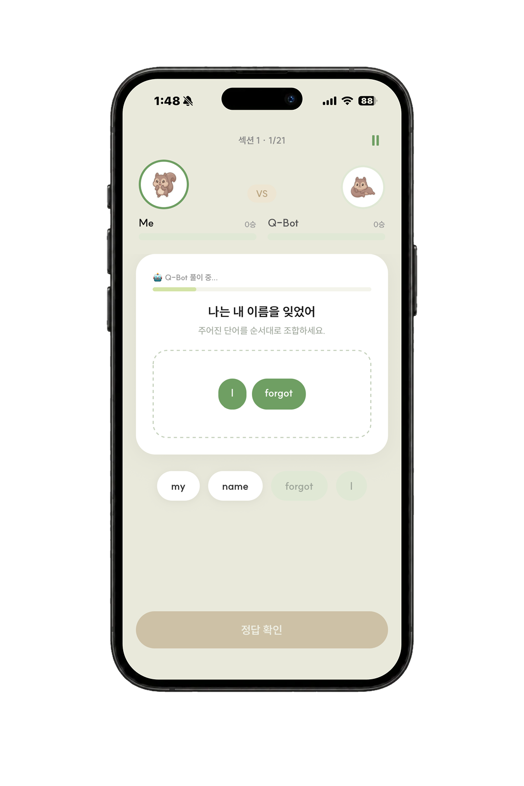
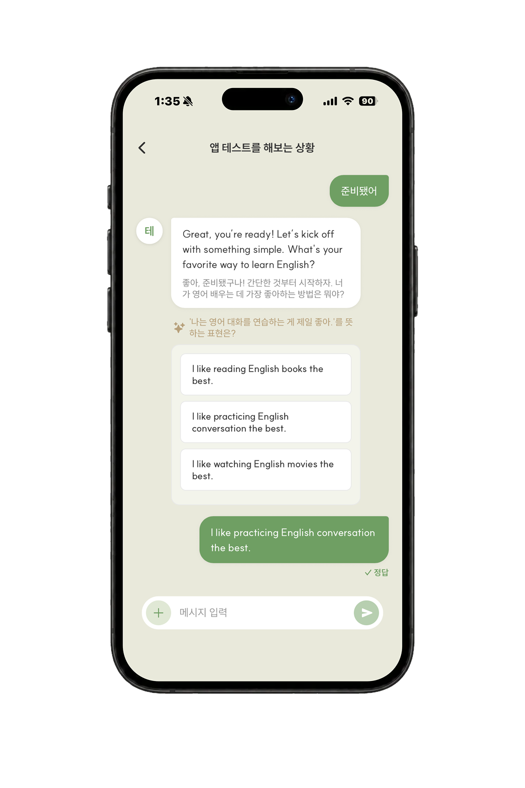
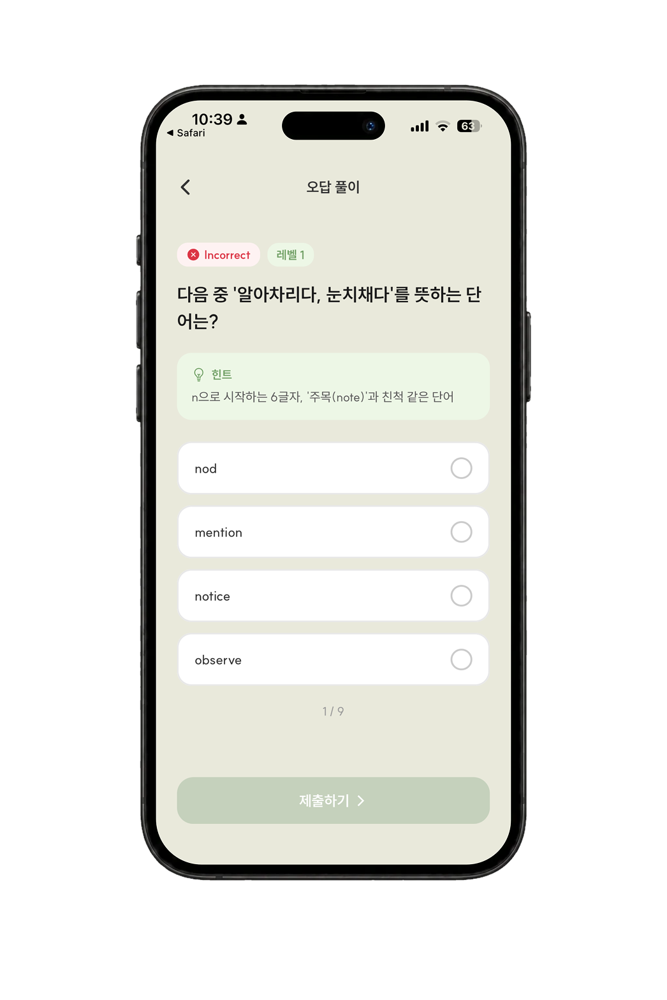
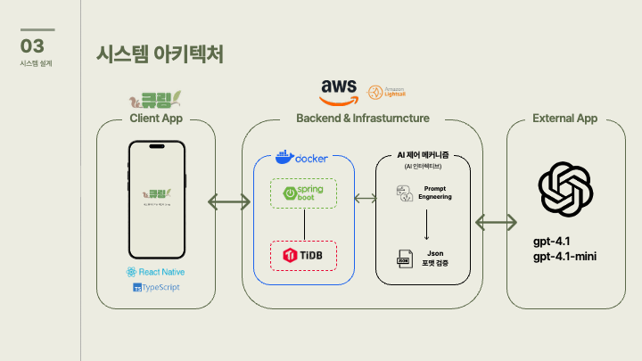
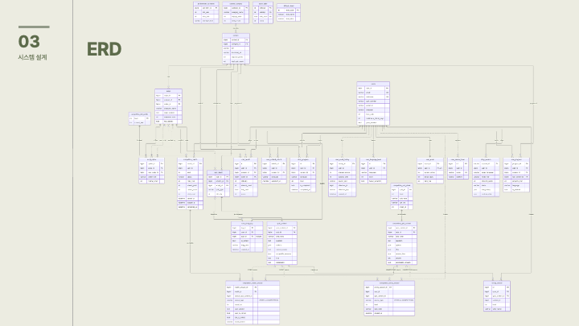

# 🍃 큐링 (Qring)
> **이야기로 배우는 외국어 — 스토리 콘텐츠 기반 다국어 학습 모바일 앱 서비스**

<p align="center">
  
</p>

<p align="center">
  <a href="https://apps.apple.com/kr/app/id6820510959" target="_blank">
    
  </a>
  <a href="https://www.youtube.com/watch?v=JKoQeEX1mdQ" target="_blank">
    
  </a>
  <a href="https://github.com/2026-dmu-quiz-language/qring_front" target="_blank">
    
  </a>
  <a href="https://github.com/2026-dmu-quiz-language/qring_backend" target="_blank">
    
  </a>
</p>

---

## 📖 프로젝트 개요
> *"매년 다짐하는 외국어 공부, 왜 중간에 포기하게 될까요?"*

미국 외교연구원(FSI) 기준, 한국인이 외국어를 유창한 수준으로 익히는 데에는 약 **2,000~2,500시간**이 소요됩니다. 긴 학습 기간 동안 단어와 문법만 기계적으로 반복하는 기존 학습 방식은 쉽게 지루함을 유발하고, 혼자서 학습 루틴을 유지하기 어렵게 만듭니다.

**큐링(Qring)** 은 학습자가 '공부를 시작한다'는 압박감 대신, **메신저 형태의 흥미로운 이야기를 읽고, 풀고, 겨루며 자연스럽게 언어를 습득하도록 설계된 게이미피케이션 외국어 학습 앱**입니다.

- **지원 언어 및 난이도:** 영어 · 중국어 · 일본어 (총 3개 언어 × 3단계 수준, 405개 핵심 문항 탑재)
- **배포 및 검증 현황:** 
  - 🍎 **iOS App Store:** 심사 통과 및 **정식 배포 완료**
  - 🤖 **Android Google Play:** 테스트 트랙 베타 테스트 진행 중
  - ✅ **품질 검증:** 총 471개 기능·예외 시나리오 테스트 통과 및 사용자 30명 대상 학습 효과 검증 완료

---

## 🧠 이론적 배경 및 차별점

### 📚 설계 이론적 근거
1. **이해 가능한 입력 가설 (Krashen, 1985):** 스토리는 한국어로 제시해 맥락을 충분히 이해하게 하고, 응답만 목표 언어로 요구하여 자연스러운 습득을 유도합니다.
2. **상황 학습 이론 (Lave & Wenger, 1991):** 단편적인 문장 암기가 아닌, 스토리 속 특정 대사에 퀴즈를 고정하여 표현이 쓰이는 실제 맥락과 함께 학습합니다.
3. **게이미피케이션 (Deterding et al., 2011):** 학습으로 획득한 포인트를 다음 콘텐츠 해금, 봇 대결, AI 스토리의 재화로 순환시켜 지속적인 학습 동기를 부여합니다.
4. **개인 맞춤형 이야기 (김하경·김동현, 2026):** 학습자가 직접 인물과 상황을 설정하는 AI 인터랙티브 스토리를 통해 어휘 학습 성과와 몰입도를 극대화합니다.

### 🔍 기존 서비스 대비 차별점
> **드릴형 앱(Duolingo)의 '명확한 학습 목표' + AI 대화형 앱(Speak)의 '맥락과 몰입'을 하나로 결합**

| 구분 | 기존 드릴형 앱 | 기존 AI 대화형 앱 | 🍃 큐링 (Qring) |
| :--- | :--- | :--- | :--- |
| **표현의 맥락** | 단어·문장 단위로 끊어서 제시 | 대화 속에 맥락 존재 | **스토리 장면에 퀴즈 고정 (화면 이탈 0회)** |
| **학습 목표** | 정해진 문제로 명확함 | 자유 대화 위주로 목표가 흐림 | **서버가 퀴즈 출제 시점·규칙·채점을 엄격 통제** |
| **동기 구조** | 스트릭·랭킹 등 누적 보상 | 대화 자체의 흥미에 의존 | **학습 보상 포인트가 다음 심화 활동을 여는 순환 구조** |
| **콘텐츠 확장** | 언어마다 콘텐츠 별도 제작 | 생성형이라 품질 통제 어려움 | **콘텐츠 3층 분리로 스토리 1개 → 3언어 × 3수준 확장** |

---

## ✨ 핵심 기능 및 학습 경로 (이해 → 몰입 → 확장)

<p align="center">
  
</p>

1. **📖 스토리 학습 (이해)**
   - 6가지 장르별 대화형 스토리를 메신저 말풍선 형태로 읽으며, 특정 대사에 도달할 때 화면 전환 없이 하단 패널로 퀴즈(스토리당 5문제)가 출제됩니다.
   - 기본 제공 스토리 외 콘텐츠는 학습으로 모은 포인트로 해금할 수 있으며, 문제마다 힌트와 즉시 해설을 제공합니다.
2. **🤖 봇 컴피티션 (몰입)**
   - 정답률로 모델링된 난이도별 Q-Bot과 포인트를 걸고 실시간 타이머 스피드 대결을 펼칩니다.
   - 객관식·주관식·단어 배열 혼합 문제(총 21문제 중 11문제 선취 승리)로 구성되며, 봇 레벨에 따른 차등 보상을 지급합니다.
3. **📝 오답 노트 (복습)**
   - 스토리 학습(3회 오답 시)과 봇 컴피티션에서 틀린 문제를 출처와 함께 최신순으로 모아 재도전할 수 있습니다.
   - 복습 부담을 낮추기 위해 문제를 다시 틀리더라도 소정의 포인트를 지급합니다.
4. **🎭 AI 인터랙티브 스토리 (확장)**
   - 학습자가 직접 대화 상대, 상황, 분위기를 설정하면 LLM이 즉석에서 역할극 대화를 생성하고 대화 흐름 속 퀴즈를 출제합니다.
   - **2티어 모델 선택 구조:** 기본 모드(`gpt-4.1-mini`, 400pt)와 프리미엄 모드(`gpt-4.1`, 550pt)를 제공하며, 포인트를 사용해 대화 저장 및 이어하기(+5문제)를 지원합니다.

---

## 📱 주요 화면 미리보기

<table align="center">
  <tr align="center">
    <td><b>홈 대시보드</b></td>
    <td><b>스토리 학습</b></td>
    <td><b>봇 컴피티션</b></td>
    <td><b>AI 인터랙티브</b></td>
    <td><b>오답 노트</b></td>
  </tr>
  <tr align="center">
    <td></td>
    <td></td>
    <td></td>
    <td></td>
    <td></td>
  </tr>
</table>

---

## 🛠 기술 스택

| 계층 | 기술 스택 | 배지 (Badge) | 상세 역할 |
| :--- | :--- | :--- | :--- |
| **Client** | React Native (Expo), TypeScript |    | 크로스 플랫폼(iOS/Android) 모바일 앱 UI/UX 구현, 소셜 로그인 및 상태 관리 |
| **Server** | Java 21, Spring Boot, JPA, Spring Security |    | JWT 기반 인증, 채점·포인트 트랜잭션 관리, AI 프롬프트 제어 및 JSON 응답 검증 |
| **Database** | TiDB Cloud (MySQL Compatible) |   | 분산 SQL 환경 구축, 콘텐츠 3층 구조 및 유저·학습·매치 이력 관계형 저장 |
| **Infra** | AWS Lightsail, Docker |   | AWS Lightsail 인스턴스 위 Docker 컨테이너 기반 서버 배포 및 안정적 운영 |
| **AI Model** | OpenAI (`gpt-4.1-mini`, `gpt-4.1`) |  | Chat Completions API 연동, 비용·품질 균형을 위한 2티어 인터랙티브 스토리 생성 |
| **Cooperation** | GitHub, Notion, VS Code |   | 버전 관리, API 명세 및 기능 테스트(471개 항목) 문서화 협업 |

---

## 🏗 시스템 아키텍처 및 핵심 설계

<p align="center">
  
</p>

### 💡 4가지 핵심 아키텍처 설계 원칙
1. **서버 중심 규칙 통제:** 클라이언트 앱은 UI 렌더링에 집중하고, 채점·포인트 산정·콘텐츠 해금 등 모든 핵심 비즈니스 규칙은 Spring Boot 서버 한곳에서 처리해 어뷰징을 방지합니다.
2. **AI 할루시네이션 다층 방어 메커니즘:** 클라이언트의 AI 직접 통신을 차단하고 백엔드가 중간에서 **프롬프트 가이드라인 주입 → JSON 포맷 강제 및 15가지 규칙 검증 → 위반 시 자동 재생성 → 출력 언어 검사 → 서버 자체 채점**의 5단계 방어 파이프라인을 수행합니다.
3. **트랜잭션 기반 포인트 정합성 보장:** 봇 대결 도중 앱이 비정상 종료되더라도 포인트 값이 어긋나지 않도록 입장료 차감과 보상 지급을 각각 독립적인 DB 트랜잭션으로 처리합니다.
4. **콘텐츠 3층 분리 구조:** 스토리 본문 · 퀴즈 위치 · 정답 정의를 공통으로 두고 언어별 문항만 추가하는 구조로 설계하여 다국어 확장 비용을 최소화했습니다.

---

## 🔥 트러블슈팅 및 기술적 의사결정

### 1. 대화형 AI 토큰 비용 폭증 방어 및 2티어 모델 설계
- **문제 상황:** AI 인터랙티브 스토리 특성상 매 턴 이전 대화 맥락이 누적 전송되면서, 전체 API 비용 중 입력 토큰 비중이 **81%**까지 치솟아 서비스 확장 시 비용 부담이 커지는 문제가 발생했습니다.
- **해결 방법:** 
  - 가성비와 응답 속도가 뛰어난 `gpt-4.1-mini`를 기본 모델(400pt)로 채택하고, 정교한 문맥 표현을 원하는 학습자를 위해 고성능 `gpt-4.1` 프리미엄 모델(550pt)을 선택할 수 있는 **2티어 과금·모델 구조**를 설계했습니다.
  - 서버단에서 15가지 규칙 기반 JSON 포맷 검증 및 자동 재생성 로직을 구현해 잘못된 포맷으로 인한 불필요한 재호출을 최소화했습니다.
- **성과:** 기본 모드 기준 턴당 API 호출 비용을 **약 0.7원 수준**으로 안정화하면서, 앱 내 학습 포인트 경제와 실제 LLM 운영 비용 간의 균형을 확보했습니다.

### 2. 실시간 봇 컴피티션 비정상 종료 시 포인트 정합성 보장
- **문제 상황:** 21문제 선취 방식의 실시간 봇 대결 도중 네트워크 단절이나 앱 강제 종료가 발생할 경우, 입장 포인트만 차감되고 매치 상태가 방치되거나 보상이 중복 지급될 위험이 있었습니다.
- **해결 방법:** 클라이언트 타이머와 서버 채점 로직을 분리하고, **매치 시작 시 입장료 차감 트랜잭션**과 **매치 종료 시 결과 반영 및 보상 지급 트랜잭션**을 원자적(Atomic) 단위로 분리하여 설계했습니다.
- **성과:** 네트워크 불안정 및 강제 종료 등 예외 테스트 시나리오에서 단 한 건의 포인트 불일치 없이 데이터 정합성을 유지했습니다.

---

## 🧬 데이터베이스 설계 (ERD)
<p align="center">
  
</p>

<details>
<summary><b>📂 프로젝트 디렉토리 구조 보기 (클릭하여 펼치기)</b></summary>

```text
📦 Qring
 ┣ 📂 qring_front (React Native / Expo)
 ┃ ┣ 📂 src
 ┃ ┃ ┣ 📂 api          # Axios 인스턴스 및 서버 API 통신 모듈
 ┃ ┃ ┣ 📂 components   # 메신저 말풍선 뷰어, 하단 퀴즈 패널, 타이머 등 공통 UI
 ┃ ┃ ┣ 📂 screens      # 홈 대시보드, 스토리 학습, 봇 컴피티션, AI 스토리, 오답 노트
 ┃ ┃ ┣ 📂 store        # 전역 상태 관리 (JWT 토큰, 보유 포인트, 학습 언어·난이도)
 ┃ ┃ ┗ 📂 utils        # 사운드 이펙트, 애니메이션 및 데이터 포맷 유틸리티
 ┃ ┗ 📜 app.json       # Expo 빌드 및 iOS/Android 스토어 배포 설정
 ┗ 📂 qring_backend (Spring Boot / Java 21)
   ┗ 📂 src/main/java/com/qring
     ┣ 📂 auth         # 소셜 로그인 및 JWT 인증·인가 필터
     ┣ 📂 story        # 3층 분리 스토리 콘텐츠 조회 및 퀴즈 채점 로직
     ┣ 📂 competition  # Q-Bot 난이도 모델링, 매칭 및 포인트 트랜잭션 처리
     ┣ 📂 ai           # OpenAI API 연동, 프롬프트 빌더, 15규칙 JSON 검증기
     ┗ 📂 wrongnote    # 오답 수집, 출처 태깅 및 복습 재도전 API
```

</details>

---

## 📊 학습 효과 검증 실험 결과

테스트 유저 30명을 **일반 학습 그룹**과 **큐링 학습 그룹**으로 나누어 3일간의 학습 자료를 제공한 뒤, 1차와 2차 테스트의 성적 변화(기억 유지율)를 비교 분석했습니다.

| 학습 유형 | 1회차 평균 | 2회차 평균 | 성적 변화율 | 기억 유지율 |
| :--- | :---: | :---: | :---: | :---: |
| **일반 학습 그룹** | 83.3점 | 65.3점 | -18.0% | 78% |
| **🍃 큐링 학습 그룹** | **80.0점** | **78.0점** | **-2.0%** | **98%** |

> 스토리 맥락 기반 학습과 즉각적인 보상·복습 피드백이 단기 암기를 넘어 높은 학습 기억 유지율로 이어짐을 확인했습니다.

---

## 📚 학술대회 논문 및 발표·전시 아카이브

### 🎓 학술 논문 발표 (2026년도 추계학술대회 학부생 논문경진대회)
- **주최:** 대한전자공학회 (IEIE)
- **논문 제목:** *스토리텔링 기반 몰입형 외국어 학습 플랫폼의 설계 및 구현*
- **핵심 요약:** 기존 드릴형 학습 앱의 맥락 단절 문제와 생성형 AI 대화 앱의 학습 목표 모호성을 해결하기 위해, 메신저형 스토리 내 퀴즈 고정 매핑 구조와 3층 분리 콘텐츠 스키마, 5단계 AI 할루시네이션 방어 파이프라인을 제안하고 실증 실험(기억 유지율 98%)을 통해 학습 효과를 검증했습니다.
- **논문 원문:** [📄 논문 PDF 다운로드](./docs/2026_IEIE_추계학술대회_논문.pdf)

### 🗂 발표 자료 및 전시 홍보물 (PPT · 브로셔 · 포스터)
| 구분 | 자료명 | 파일 링크 |
| :--- | :--- | :---: |
| **1학기 중간발표** | 프로젝트 기획 배경 및 요구사항 정의 | [📊 PPT 보기](./docs/1학기_중간발표.pdf) |
| **1학기 기말발표** | 초기 프로토타입 구현 및 시스템 아키텍처 설계 | [📊 PPT 보기](./docs/1학기_기말발표.pptx) |
| **2학기 중간발표** | 다국어 확장(한·중·일) 및 AI 인터랙티브 스토리 고도화 | [📊 PPT 보기](./docs/2학기_중간발표.pptx) |
| **2학기 기말발표** | 최종 서비스 구현, 학습 효과 검증(30명) 및 스토어 출시 보고 | [📊 PPT 보기](./docs/2학기_기말발표.pptx) |
| **전시 브로셔** | 졸업작품 전시회 프로젝트 소개 브로셔 | [📑 브로셔 보기](./docs/큐링_브로셔.pdf) |
| **전시 포스터** | 서비스 구조 및 핵심 성과 요약 포스터 | [🖼 포스터 보기](./docs/큐링_포스터.pdf) |

---

## 🎬 시연 영상

이미지를 클릭하시면 **큐링(Qring) 최신 버전 구동 시연 영상**을 바로 시청하실 수 있습니다.

<div align="center">
  <a href="https://www.youtube.com/watch?v=JKoQeEX1mdQ">
    
  </a>
  <br />
  <sub>▲ 클릭 시 YouTube 시연 영상으로 이동합니다</sub>
</div>

---

## 🚀 로컬 실행 가이드 (Getting Started)

### 1. Frontend (`qring_front`)
```bash
# 레포지토리 클론 및 이동
git clone [https://github.com/2026-dmu-quiz-language/qring_front.git](https://github.com/2026-dmu-quiz-language/qring_front.git)
cd qring_front

# 패키지 설치
npm install

# 환경 변수 설정 (.env 파일 생성)
echo "EXPO_PUBLIC_API_BASE_URL=http://localhost:8080" > .env

# Expo 개발 서버 실행
npx expo start
```

### 2. Backend (`qring_backend`)
```bash
# 레포지토리 클론 및 이동
git clone [https://github.com/2026-dmu-quiz-language/qring_backend.git](https://github.com/2026-dmu-quiz-language/qring_backend.git)
cd qring_backend

# 환경 변수 설정 (application.yml 또는 환경변수 주입)
# DB_URL, DB_USERNAME, DB_PASSWORD, JWT_SECRET, OPENAI_API_KEY

# 빌드 및 실행
./gradlew bootRun
```

---

## 👨‍💻 팀 구성 및 역할 (동양미래대학교 컴퓨터소프트웨어공학과)

| 이름 | 역할 | 주요 담당 업무 |
| :--- | :--- | :--- |
| **박수현 (팀장)** | Frontend / PM | 프로젝트 총괄 기획, UI/UX 설계, React Native 기반 코어 앱 아키텍처 및 주요 화면 개발 |
| **임태형** | Backend / Infra | AWS Lightsail 및 Docker 컨테이너 기반 서버 인프라 구축, 백엔드 API 및 배포 환경 운영 |
| **김영우** | Frontend / Gamification | 스토리 뷰어 및 봇 컴피티션·게이미피케이션 인터랙션 로직 개발, 인앱 애니메이션 구현 |
| **채다현** | Backend / DBA | TiDB Cloud 기반 관계형 DB(ERD) 설계, JWT 인증, AI 제어 파이프라인 및 백엔드 API 개발 |

---

## 📌 향후 계획
- [x] 핵심 기능 471개 테스트 완료 및 iOS App Store 정식 출시
- [ ] Android Google Play 스토어 정식 출시
- [ ] 지원 언어 및 장르별 스토리 콘텐츠 지속 확장
- [ ] CEFR 등 공인 어학 등급 체계에 맞춘 난이도 정밀 정렬 및 장기 학습 효과 평가
